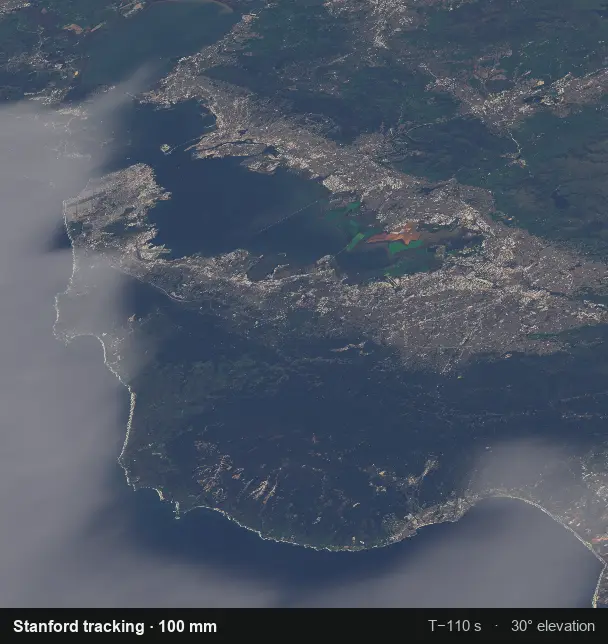
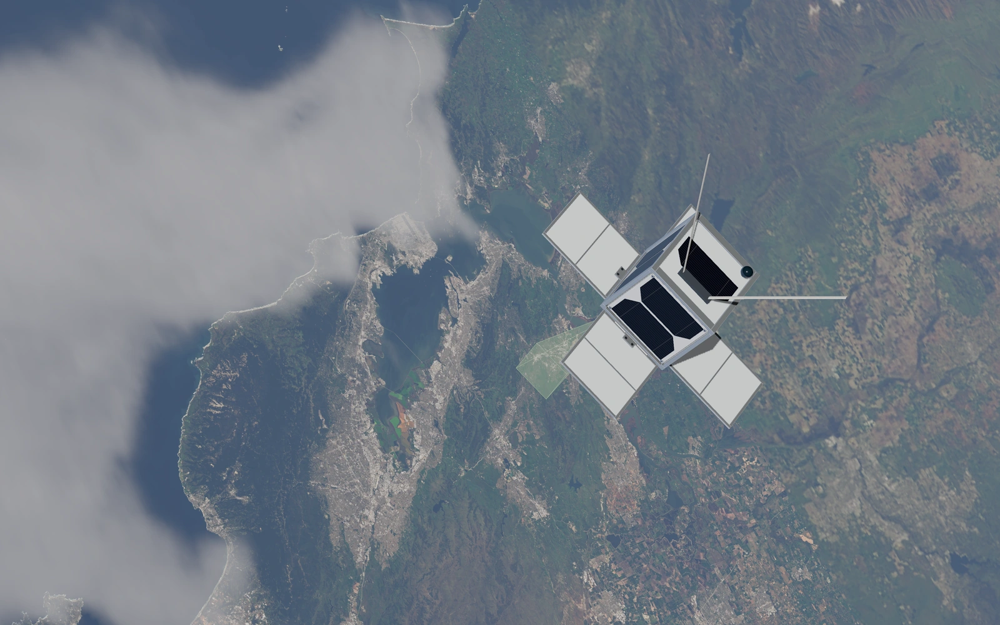

# Field of View

[Open the simulator](https://rivercraft911.github.io/cubesat-imaging-sim/)

Fly a 1U CubeSat over Stanford at 550 km. Change lenses, aim the fisheye pair, or compare a full-resolution frame with the video received over the downlink.

**Daylight flyover** · The stitched 360° panorama and the main camera looking straight down, side by side.


**Tracking Stanford** · A 100 mm lens holds campus at the center from 110 seconds before closest approach to 110 seconds after.



**Above the Bay** · The rear dipole and four deployed wings, with the 25 mm main camera’s field of view in green.



## Run locally

Use Node.js 22.12 or newer.

```sh
npm ci --legacy-peer-deps
npm run dev
```

Open [localhost:5174](http://127.0.0.1:5174/) in a WebGPU-capable browser.

Pass imagery contains modified Copernicus Sentinel data 2025. [Imagery credits](public/assets/NOTICE.md) · [Model assumptions](docs/models.md)
