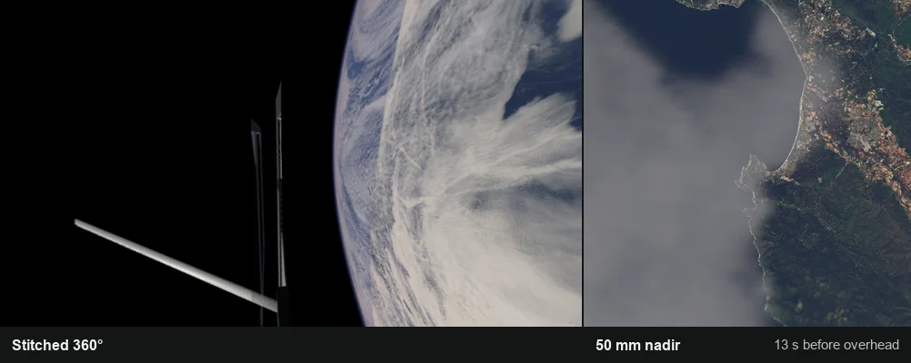

# Field of View

[Open the simulator](https://rivercraft911.github.io/cubesat-imaging-sim/)

Fly a 1U CubeSat over Stanford at 550 km. Change lenses, aim the fisheye pair, or compare a full-resolution frame with the video received over the downlink.

**Stitched 360° view** · Two Sony IMX676 sensors with 2.13 mm f/2.8 fisheyes, each covering 190°. At right, a third IMX676 looks straight down through a 50 mm f/4 lens.



**Tracking Stanford** · A Sony IMX676 with a 100 mm f/4 lens holds campus in frame for 220 seconds. Each 3536 × 3536 frame (12.5 MP) is scaled to 608 pixels wide for this preview.


The 25 mm main camera’s field of view is highlighted in green.


## Run locally

Use Node.js 22.12 or newer.

```sh
npm ci --legacy-peer-deps
npm run dev
```

[Model assumptions](docs/models.md)
